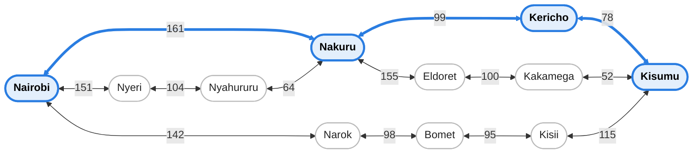
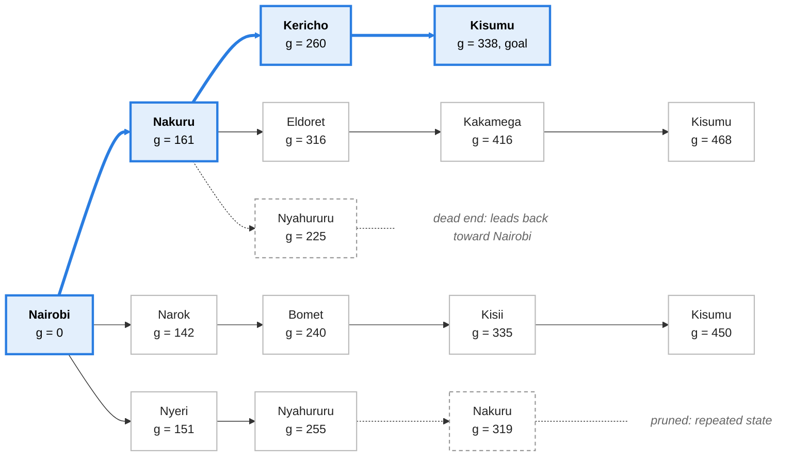

# Self-Driving Trailer Agent: PEAS, Graph, Search Tree and Optimal Path

BBT 3201 Artificial Intelligence, Topic 3: Problem Solving Agents.
Lecturer: Allan Vikiru. Student: [name], Adm. No: [number].

---

## Question 1: PEAS and Environment

### 1.1 PEAS description

| Element | Description |
|---|---|
| **Performance measure** | Minimise total distance (km) from origin to destination; arrive safely with the cargo intact; no collisions; obey traffic rules and speed limits; keep fuel use and travel time low. |
| **Environment** | Kenya's highway network: tarmac highways (A104, B1, B3, A2 and others), towns and junctions, other vehicles (matatus, buses, trucks, motorbikes), pedestrians and animals, traffic signs and signals, weather and road conditions. |
| **Actuators** | Steering, accelerator, brakes (including trailer brakes), gear and transmission control, indicators, headlights, horn, hazard lights. |
| **Sensors** | GPS, digital map, cameras, LiDAR, radar, speedometer and odometer, gyroscope/accelerometer (IMU), fuel gauge, tyre-pressure and load sensors, rain/light sensors. |

### 1.2 Properties of the environment

| Property | Classification | Justification |
|---|---|---|
| **Observability** | Partially observable | Sensors cannot see around bends or over crests, behind other vehicles, or the intentions of other drivers. Road surface condition and sudden hazards are only detected at short range. |
| **Determinism** | Stochastic | The next state is not fully determined by the current state and the agent's action. Other drivers, weather, potholes, breakdowns and roadworks add uncertainty. |
| **Episodic vs sequential** | Sequential | Each decision (route choice, overtaking, braking) affects later states and decisions. Choosing the Narok road at Nairobi rules out the Nakuru road. |
| **Static vs dynamic** | Dynamic | The environment changes while the agent is deciding: traffic, weather and pedestrians keep moving. |
| **Single agent vs multi-agent** | Multi-agent | The trailer shares the road with other agents: matatus, buses, trucks, motorbikes and pedestrians. Their actions change what the trailer should do, for example when overtaking or braking. |

---

## Question 2: Problem Formulation, Directed Graph and Search Tree

### 2.1 Problem formulation

The trailer is a goal-based problem-solving agent: it searches for a sequence of actions that takes it from the initial state to the goal state.

- **Goal formulation:** Initial state is Nairobi; goal state is Kisumu.
- **Initial state:** Nairobi (NBO).
- **State space:** the towns in the abstracted network (table below). Actions at each state are the roads that lead to a neighbouring town, executed through low-level actions such as accelerate, brake and turn left or right.
- **Goal test:** is the current town Kisumu?
- **Path cost function:** road distance in km between towns. Path cost is the sum of the step costs.

### 2.2 Directed graph (state space)

Nodes are towns and arcs are the road links (actions). Every road can be driven both ways, so each link below is two arcs of equal cost (A to B and B to A). Numbers on the arcs are road distances in km. The highlighted (blue) nodes and thick arcs are the optimal path found in Question 3: Nairobi, Nakuru, Kericho, Kisumu = 338 km.

The table below lists every arc (each is drivable in both directions).

| From | To | Distance (km) | Region (of the origin town) |
|---|---|---|---|
| Nairobi | Nakuru | 161 | Nairobi to Rift Valley |
| Nairobi | Narok | 142 | Nairobi to Rift Valley |
| Nairobi | Nyeri | 151 | Nairobi to Central Highlands |
| Nyeri | Nyahururu | 104 | Central Highlands |
| Nyahururu | Nakuru | 64 | Central Highlands to Rift Valley |
| Nakuru | Kericho | 99 | Rift Valley |
| Nakuru | Eldoret | 155 | Rift Valley |
| Narok | Bomet | 98 | Rift Valley |
| Bomet | Kisii | 95 | Rift Valley to Lake Victoria Basin |
| Kericho | Kisumu | 78 | Rift Valley to Lake Victoria Basin |
| Kisii | Kisumu | 115 | Lake Victoria Basin |
| Eldoret | Kakamega | 100 | Rift Valley to Lake Victoria Basin |
| Kakamega | Kisumu | 52 | Lake Victoria Basin |

**Distances:** the Nairobi to Nakuru, Nakuru to Nyahururu, Nairobi to Nyeri and Nyeri to Nyahururu figures come from the lecture notes. The other figures are approximate road distances between town centres.

### 2.3 Abstraction

Abstraction leaves out details that do not help solve the search problem:

- **Intermediate towns merged into one arc:** Naivasha is merged into Nairobi to Nakuru (161 km), and Molo into Nakuru to Kericho (99 km). The trailer does not make a routing decision there.
- **Towns left out:** Thika, Ruiru, Embu, Nanyuki, Kilgoris and Kisii-side towns that do not lie on any sensible Nairobi to Kisumu route.
- **Actions left out:** lane changes, speed adjustments and traffic lights. Only the route-level action "drive from town A to town B" is kept.
- **Branch pruned:** following the class example, the Nyeri branch is not expanded. Nairobi to Nyeri to Nyahururu to Nakuru costs 319 km to reach Nakuru, against 161 km direct, and Nakuru is a repeated state.

### 2.4 Search tree

The tree starts at the root (Nairobi). Each node shows the town and the cumulative path cost g(n) in km. Blue nodes are the optimal path; dashed nodes are pruned branches or dead ends.

The goal test passes first at Kisumu with g = 338 km. The other two routes to Kisumu cost 450 km and 468 km.

---

## Question 3: Optimal Path from Nairobi to Kisumu

With distance as the path cost, the agent uses **uniform-cost search** (Dijkstra's algorithm). The frontier is a priority queue ordered by lowest g(n), and the first time the goal is removed from the frontier its path is optimal.

### 3.1 Uniform-cost search trace

| Step | Node expanded (g) | New nodes added to the frontier |
|---|---|---|
| 1 | Nairobi (0) | Nakuru 161, Narok 142, Nyeri 151 |
| 2 | Narok (142) | Bomet 240 |
| 3 | Nyeri (151) | Nyahururu 255 |
| 4 | Nakuru (161) | Kericho 260, Eldoret 316; Nyahururu improved from 255 to 225 |
| 5 | Nyahururu (225) | none (neighbours already expanded) |
| 6 | Bomet (240) | Kisii 335 |
| 7 | Kericho (260) | Kisumu 338 |
| 8 | Eldoret (316) | Kakamega 416 |
| 9 | Kisii (335) | Kisumu 450 (worse than 338, discarded) |
| 10 | **Kisumu (338)** | **Goal test passed, stop** |

### 3.2 Candidate routes

| Route | Calculation | Total (km) |
|---|---|---|
| **Nairobi, Nakuru, Kericho, Kisumu** | 161 + 99 + 78 | **338** |
| Nairobi, Narok, Bomet, Kisii, Kisumu | 142 + 98 + 95 + 115 | 450 |
| Nairobi, Nakuru, Eldoret, Kakamega, Kisumu | 161 + 155 + 100 + 52 | 468 |

### 3.3 Solution

The optimal path is **Nairobi to Nakuru to Kericho to Kisumu, a path cost of 338 km** (on the road, via Naivasha and Molo). It is about 112 km shorter than the next best route through Narok, so small errors in the estimated distances would not change the answer. The agent then executes it: Nairobi to Nakuru, Nakuru to Kericho, Kericho to Kisumu, performing the goal test at each town.

---

